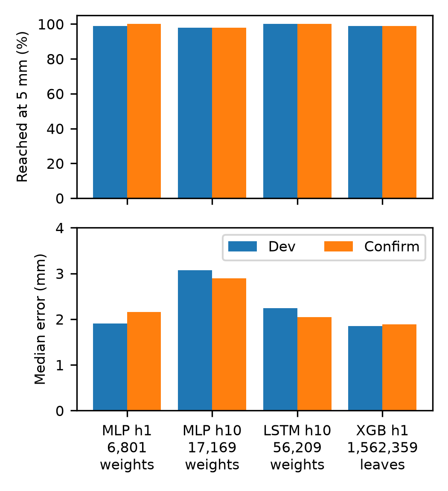

# Robust Imitation Learning for Mobile Robots

Behavior cloning for a simulated mobile manipulator: a small neural network
learns to copy an expert controller that drives a Robotnik mobile base to a
target, parks, and reaches the target with a Kinova arm, in PyBullet.

The final model, an ensemble of three MLPs with 6,801 weights each, matches the
expert on held-out targets and decides in 38 µs. The [report](docs/report.pdf)
describes the method and experiments in full; this file explains how to run the
code.

## Highlights

### Result

- **Matches the expert:** the task counts a target as reached when the hand ends
  within 1 cm, and the final model reaches all 100 unseen targets, as the expert
  does. Once several models hit 100, I added a stricter 5 mm test to separate
  them; the final model passes it on 99, the expert on 100.
- **Small and fast:** three MLPs of 6,801 weights each decide in 38 µs, over 250
  times inside the 10 ms control period.

### Method, in the order it was built

- **A redesigned, memoryless expert:** the supplied expert switched between
  hidden phases, so the same state could call for different commands. Its
  replacement depends only on measurable state, which lifted the same network
  and recipe from 65 to 96 of 100 targets.
- **Inputs chosen against causal confusion:** the network sees only what the
  expert's control laws read, in the base's frame. With the robot's own speeds
  as inputs, it fit the data far better (validation loss 0.024 against 0.082)
  yet reached no target, because it learned to continue whatever the robot was
  already doing.
- **A separate parked head:** a small head reads only the goal inputs and
  latches the switch from driving to reaching, which stopped the network from
  judging the base parked whenever the arm moved.
- **DART:** half the demonstrations add noise to the expert's executed commands,
  so the data cover the states a drifting policy reaches. Under command noise at
  1× and 2× the training level, the final model reaches 100 and 99 targets,
  against 78 and 38 without DART.
- **A compact network and an ensemble:** two layers of 64 and a 16-wide head cut
  the weights twelvefold while raising precision, and averaging three networks
  lifted success at 5 mm from 87 to 96.
- **Prioritized replay:** training revisits the demonstrations the network
  handles worst more often, the machine-learning counterpart of the hippocampus
  favoring some experiences when it replays them. It lifted the ensemble from 96
  to 99 targets at 5 mm and cut the median error from 2.7 to 1.9 mm.

### Experiments

- **Every choice made in closed loop:** offline validation loss only loosely
  predicted driving success (r = -0.64), so each change was judged by running
  the robot, on separate seed sets for choosing, confirming, and reporting, with
  tie rules fixed beforehand.
- **Sequence models and trees compared:** a 10-step history MLP, an LSTM, and an
  XGBoost mixture of experts match the final model's accuracy at up to 340 times
  its decision time; XGBoost's 13 ms exceeds the control period.
- **Robustness tests and a fix:** sensor noise, command noise, wider task
  ranges, and sideways pushes expose the policy's limits. Training on pushed
  demonstrations raised success under 0.1 m/s pushes from 66 to 97 and under 5
  mm sensor noise from 79 to 98.
- **A diagnosed negative result:** DAgger cut success at 5 mm from 96 to 30,
  because the expert's arm keeps hidden state, and its labels reverse when the
  learner drives (label cosine -0.15 against +0.21).

## Table of Contents

- [Highlights](#highlights)
- [Background](#background)
- [Requirements](#requirements)
- [Quick Start](#quick-start)
- [Pre-trained Models](#pre-trained-models)
- [Evaluation](#evaluation)
- [Training](#training)
- [Results](#results)
- [Repository Layout](#repository-layout)
- [Tests](#tests)
- [Author and Origin](#author-and-origin)
- [Acknowledgments](#acknowledgments)

## Background

The policy decides every 10 ms (100 Hz), and fixed 1 kHz controllers carry out
its commands on the wheels and the arm joints.

- **Inputs (18 per step):** the target and the hand-to-target error in the
  base's frame, the 7 arm joint angles, the standoff point in the base's frame,
  the distance still to cover, and the direction of the target. The robot's own
  speeds are left out, because with them the network learned to keep doing
  whatever the robot was already doing.
- **Outputs:** forward speed, turning rate, 7 joint target offsets, 7 joint
  target speeds, and the probability that the base has parked. Until the base is
  judged parked, only the base commands are used and the arm holds its start
  pose; after that, only the arm commands are used and the wheels stop.
- **Expert:** turns toward the target while driving to a standoff distance that
  depends on the target's height, then reaches with the arm.
- **Training:** 300 clean demonstrations and 300 with noise added to the
  executed commands (DART), with prioritized replay. Three networks trained with
  different seeds are averaged.
- **Inference:** each MLP runs as a NumPy copy, and a decision of the
  three-network ensemble takes about 38 µs. The LSTM runs on PyTorch.

## Requirements

The code runs in the `ml` environment of the course's RoboEnv repository, plus
XGBoost for the tree policy.

1. Get RoboEnv and create its `ml` environment:

   ```bash
   git clone --recurse-submodules https://github.com/VModugno/RoboEnv.git
   cd RoboEnv
   pixi install -e ml
   ```

2. Activate the environment, in every new terminal:

   ```bash
   cd <path-to-RoboEnv>
   pixi shell -e ml
   ```

3. Move into this repository and install XGBoost, once:

   ```bash
   cd <path-to-this-repository>
   python -m pip install -r requirements.txt
   ```

All commands below run from the repository root with the environment active. The
code was developed and tested with Python 3.14 and PyTorch 2.11, as installed by
the `ml` environment, and XGBoost 3.4.1.

## Quick Start

```bash
python demo.py
```

This opens the PyBullet window and runs the final model.

```bash
python demo.py [POLICY] [--seed S] [--episodes N]
```

| `POLICY`       | Runs                                                                           |
| -------------- | ------------------------------------------------------------------------------ |
| _(omitted)_    | The final model                                                                |
| `mlp`          | MLP that sees the current step                                                 |
| `mlp-push`     | The final MLP, also trained on 300 demonstrations with a sideways push         |
| `mlp-history`  | MLP that sees the last 10 steps                                                |
| `mlp-baseline` | MLP trained by plain behavior cloning: clean demonstrations, no DART or replay |
| `lstm`         | LSTM that sees the last 10 steps                                               |
| `xgb`          | Gradient-boosted trees (XGBoost) that see the current step                     |
| `expert`       | The expert controller                                                          |

Each learned model is an ensemble of three, trained with different seeds; `xgb`
needs its models rebuilt first (see [Pre-trained Models](#pre-trained-models)).
`POLICY` can also be any checkpoint name, or several joined by commas. `--seed`
sets the first episode, and `--episodes` how many to play.

To run the expert on the template's fixed target, with the template's plots:

```bash
python robotnik_arm_task.py
```

## Pre-trained Models

Every trained network is included in `checkpoints/`, so no training is needed to
run the demo or check the results.

| Model            | Checkpoints                          | Size per model |
| ---------------- | ------------------------------------ | -------------- |
| MLP (final)      | `v2-08-replay-gentle/s0`, `s1`, `s2` | 6,801 weights  |
| MLP, push        | `v2-13-push/s0`, `s1`, `s2`          | 6,801 weights  |
| MLP, history 10  | `v2-09-mlp-h10/s0`, `s1`, `s2`       | 17,169 weights |
| MLP, baseline    | `v2-11-mlp-baseline/s0`, `s1`, `s2`  | 6,801 weights  |
| LSTM, history 10 | `v2-10-lstm-h10/s0`, `s1`, `s2`      | 56,209 weights |
| XGBoost          | `v2-12-xgb/s0`, `s1`, `s2`           | ~1.4 M leaves  |

`s0`, `s1`, and `s2` are the same model trained with three random seeds.

The XGBoost model files are the exception: each arm model is over 100 MB, past
GitHub's file limit, so only their training records (`trees.json`) are included.
To rebuild them, collect the datasets (step 1 of [Training](#training)), then
run:

```bash
for seed in 0 1 2; do
  python train_xgb.py v2-12-xgb/s$seed --data v2-clean-300 v2-dart4-300 --seed $seed
done
```

Checkpoint names are organized as follows:

| Name         | Contents                                                                              |
| ------------ | ------------------------------------------------------------------------------------- |
| `v2-NN-...`  | The main line, numbered in the order it was built                                     |
| `sweep/...`  | Size, learning-rate, done-head, data, replay, and push sweeps                         |
| `robust/...` | Robustness and generalization results (evaluations only)                              |
| `v1/...`     | Models for an earlier expert, kept as a record; they do not run with the current code |

## Evaluation

```bash
python evaluate.py POLICY [--name NAME] [--seed S] [--episodes N] [--tolerance T]
```

This runs the episodes in parallel, prints each outcome and a summary, and saves
the results to `evaluations/NAME.json`. `POLICY` is `expert`, a checkpoint name,
or several joined by commas. `--tolerance` is the success distance in meters
(default 0.01). For a trained policy, the time of one model decision is measured
first, as the fastest of 5 runs of 100 decisions on one CPU thread.

Three sets of episode seeds are kept apart, so no setting is chosen on the
episodes used to report it:

| `--seed`       | Set          | Use                            |
| -------------- | ------------ | ------------------------------ |
| 1000 (default) | Development  | Choosing settings              |
| 5000           | Confirmation | Checking a choice once made    |
| 6000           | Final        | The report's results, run once |

For example, the final model on the final seeds at 1 cm and at 5 mm:

```bash
python evaluate.py v2-08-replay-gentle/s0,v2-08-replay-gentle/s1,v2-08-replay-gentle/s2 --name final --seed 6000
python evaluate.py v2-08-replay-gentle/s0,v2-08-replay-gentle/s1,v2-08-replay-gentle/s2 --name final-tol5 --seed 6000 --tolerance 0.005
```

Each run of 100 episodes takes about 20 s on a laptop.

### Robustness and Generalization

These options test a policy outside the conditions it was trained in:

| Option          | Effect                                                                                |
| --------------- | ------------------------------------------------------------------------------------- |
| `--ranges wide` | Base starts up to 1 m out, targets 0.4–2.0 m away and 0.15–1.2 m high                 |
| `--obs-noise S` | Gaussian noise of standard deviation S on every measured position (m) and angle (rad) |
| `--cmd-noise K` | Noise on the executed commands, K times the DART noise of the training data           |
| `--push V`      | Sets the base sliding sideways at V m/s, to its left, 2 s into the episode            |

For example, the final model under 2 mm sensor noise on the final seeds:

```bash
python evaluate.py v2-08-replay-gentle/s0,v2-08-replay-gentle/s1,v2-08-replay-gentle/s2 --name robust/final-obs2 --seed 6000 --obs-noise 0.002
```

Under wide ranges, episodes stop once the hand is within 1 cm after 8 s, so the
median error sits near 10 mm by design; compare success counts instead.

### Summary Table

```bash
python summarize.py               # main line
python summarize.py sweep         # sweeps
python summarize.py robust        # robustness and generalization
python summarize.py --csv FILE    # also save the table as CSV
```

Each row is one checkpoint or ensemble, joined to the evaluation of the same
name:

| Column                   | Meaning                                                                                                        |
| ------------------------ | -------------------------------------------------------------------------------------------------------------- |
| `network`                | Type, layers x width, history, and done-head width (tree depth for XGBoost); ensembles show their member count |
| `weights`                | Learned weights, or leaves for XGBoost, summed over an ensemble's members                                      |
| `best epoch`, `val loss` | Best epoch and its validation loss (single networks only)                                                      |
| `train s`                | Training time to the best epoch (the whole fit for XGBoost), summed over an ensemble                           |
| `reached`                | Episodes within the tolerance at the end                                                                       |
| `2 cm`                   | Episodes within 2 cm at the end                                                                                |
| `median mm`              | Median final distance from the target                                                                          |
| `late`                   | Episodes that reached only after the 8 s minimum                                                               |
| `park s`, `tol s`        | Mean time to park, and to come within the tolerance                                                            |
| `decision us`            | Time of one model decision, in microseconds                                                                    |
| `confirm ...`            | The same model on the confirmation seeds                                                                       |
| `final ...`              | The same model on the final seeds                                                                              |

Names ending in `-tol5` are evaluated at 5 mm, and names ending in `-confirm` or
`-final` on the confirmation or final seeds.

Models are ranked by success at 1 cm, then at 5 mm, then by median error, then
by speed and size. Success counts within 8 of each other over 500 episodes count
as a tie. Validation loss is reported but not used for ranking: lower loss
broadly means more success (r = -0.64 over the sweeps), but networks with the
same loss differed by up to 30 points in success.

### Figures

```bash
python plot_results.py
```

This writes the report's figures to `figures/` as PDF and PNG.

## Training

The datasets are not included because of their size. These commands rebuild them
exactly, since each episode is fixed by its seed.

1. Collect demonstrations:

   ```bash
   python collect_data.py v2-clean-300 --episodes 300
   python collect_data.py v2-dart4-300 --seed 300 --episodes 300 --v-noise 0.0156 --w-noise 0.137 --q-noise 0.004
   ```

   The second set adds noise to the executed commands, while recording the
   expert's commands as labels. The noise levels were chosen with
   `dart_noise.py`, which estimates them from a trained network's validation
   errors:

   ```bash
   python dart_noise.py CHECKPOINT [--scale K]
   ```

   The push model also uses a third set, in which each episode gets one sideways
   push of 0.05–0.25 m/s, to the left or right, 0.5–2.5 s in:

   ```bash
   python collect_data.py v2-push-300 --seed 600 --episodes 300 --push-speed 0.05 0.25
   ```

2. Train three networks:

   ```bash
   for seed in 0 1 2; do
     python train.py final/s$seed --data v2-clean-300 v2-dart4-300 --seed $seed --replay-alpha 0.3 --replay-beta 1
   done
   ```

   The other defaults in `train.py` are the chosen settings. For the compared
   models, change the command as follows:

   | Model            | Change                                                            |
   | ---------------- | ----------------------------------------------------------------- |
   | MLP, push        | Add `v2-push-300` to `--data`                                     |
   | MLP, history 10  | Add `--history 10`                                                |
   | MLP, baseline    | Use `--data v2-clean-300` only, and drop both `--replay-` options |
   | LSTM, history 10 | Add `--kind lstm --history 10`                                    |

   The XGBoost policy trains with `train_xgb.py` on the same data, as shown in
   [Pre-trained Models](#pre-trained-models).

3. Evaluate the ensemble:

   ```bash
   python evaluate.py final/s0,final/s1,final/s2 --name final
   ```

Each step writes to its own folder: `data/NAME/`, `checkpoints/NAME/`, and
`evaluations/NAME.json`.

## Results

Each model ran once on the 100 final episodes (seeds from 6000):

| Model            | 1 cm | 5 mm | Median error (mm) | Size per model |
| ---------------- | ---: | ---: | ----------------: | -------------- |
| Expert           |  100 |  100 |               1.9 | -              |
| MLP (final)      |  100 |   99 |               2.3 | 6,801 weights  |
| MLP, push        |   99 |   95 |               3.0 | 6,801 weights  |
| MLP, history 10  |   99 |   97 |               2.8 | 17,169 weights |
| MLP, baseline    |   92 |   69 |               5.0 | 6,801 weights  |
| LSTM, history 10 |  100 |  100 |               2.1 | 56,209 weights |
| XGBoost          |  100 |  100 |               1.8 | ~1.4 M leaves  |

A decision of the three-model ensemble takes about 38 µs for the MLPs, 820 µs
for the LSTM, and 13 ms for XGBoost, longer than the 10 ms control period.

Success at 1 cm under the robustness and generalization tests, on the same
episodes:

| Condition             | Expert | MLP (final) | MLP, push | MLP, history | MLP, baseline | LSTM | XGBoost |
| --------------------- | -----: | ----------: | --------: | -----------: | ------------: | ---: | ------: |
| Wide ranges           |    100 |          79 |        76 |           81 |            65 |   80 |      75 |
| Sensor noise 0.002    |    100 |         100 |        99 |           96 |            61 |  100 |     100 |
| Sensor noise 0.005    |    100 |          79 |        98 |           29 |             5 |   77 |      86 |
| Command noise 1x DART |    100 |         100 |        99 |          100 |            78 |  100 |     100 |
| Command noise 2x DART |    100 |          99 |        99 |           90 |            38 |   97 |     100 |
| Push 0.1 m/s          |    100 |          66 |        97 |           53 |            38 |   65 |      99 |
| Push 0.2 m/s          |     94 |           2 |        57 |            2 |             1 |    2 |      38 |

Among the models that decide within the 10 ms control period, the push model is
the most robust, but it missed the rule set before testing for replacing the
final model: 100 of 100 at 1 cm and at least 98 at 5 mm on the development and
confirmation seeds. XGBoost recovers from 0.1 m/s pushes without push training,
but cannot run in real time.



## Repository Layout

```text
collect_data.py       ->  data/NAME/              demonstrations
train.py              ->  checkpoints/NAME/       trained network and losses
train_xgb.py          ->  checkpoints/NAME/       trained tree policy and record
dart_noise.py         ->  DART noise levels for collect_data.py
evaluate.py           ->  evaluations/NAME.json   held-out results
summarize.py          ->  table of every checkpoint and evaluation
plot_results.py       ->  figures/                the report's figures
demo.py               ->  PyBullet window
robotnik_arm_task.py  ->  the expert on the template's target, with plots
```

| Path                                | Contents                                            |
| ----------------------------------- | --------------------------------------------------- |
| `behavior_cloning/robot.py`         | Robot constants: joint indices and finger pose      |
| `behavior_cloning/env.py`           | PyBullet scene and robot measurements               |
| `behavior_cloning/control.py`       | Control laws for base navigation and arm reaching   |
| `behavior_cloning/expert.py`        | The expert and its standoff table                   |
| `behavior_cloning/episode.py`       | Running an episode and its stop criteria            |
| `behavior_cloning/data.py`          | Episode sampling, DART noise, DAgger, and recording |
| `behavior_cloning/perturbations.py` | Noise, pushes, and push sampling for robustness     |
| `behavior_cloning/features.py`      | Network inputs and labels                           |
| `behavior_cloning/model.py`         | Networks, ensembles, and NumPy inference            |
| `behavior_cloning/replay.py`        | Prioritized replay for training                     |
| `behavior_cloning/trees.py`         | Gradient-boosted tree policy (XGBoost)              |
| `behavior_cloning/learned.py`       | Loading a trained model and running it on the robot |
| `behavior_cloning/paths.py`         | Folder locations                                    |
| `checkpoints/`                      | Trained models                                      |
| `evaluations/`                      | Evaluation results                                  |
| `figures/`                          | Report figures                                      |
| `models/`, `configs/`               | Robot description from the course                   |
| `tests/`                            | Unit tests                                          |
| `requirements.txt`                  | Packages needed beyond RoboEnv                      |

## Tests

```bash
python -m unittest discover -s tests
```

The tests cover the control laws, input features, networks and their NumPy
copies, tree policies, prioritized replay, perturbations and pushes, the learned
policy's gating, and DAgger labeling.

## Author and Origin

William Tremaglio.

This project began as group coursework for UCL's Machine Learning for Robotics
module. Each member tackled the problem independently, and the group then
submitted the strongest implementation. This repository is my implementation,
which the group submitted. It includes a gradient-boosted tree (XGBoost) policy
that a teammate developed and I adapted to this pipeline.

## Acknowledgments

| Path                                                | Source                                                                                             | Status                                                         |
| --------------------------------------------------- | -------------------------------------------------------------------------------------------------- | -------------------------------------------------------------- |
| RoboEnv                                             | [VModugno/RoboEnv](https://github.com/VModugno/RoboEnv)                                            | Used unchanged; not included                                   |
| `models/`, `configs/`                               | [LAB_SESSION_COMP_0245_2026_PUBLIC](https://github.com/VModugno/LAB_SESSION_COMP_0245_2026_PUBLIC) | Unchanged                                                      |
| `robotnik_arm_task.py`                              | Same repository                                                                                    | Rewritten to run this expert; same target, printout, and plots |
| `behavior_cloning/robot.py`, `env.py`, `episode.py` | Template's `robotnik_arm_task.py` and `robotnik_arm_control.py`                                    | Restructured; same simulation settings                         |
| `behavior_cloning/control.py`                       | Template's `robotnik_arm_control.py`                                                               | New base controller; arm controller restructured               |
| `behavior_cloning/trees.py`, `train_xgb.py`         | A teammate's XGBoost policy                                                                        | Adapted to this pipeline                                       |
| All other files                                     | This project                                                                                       | Written from scratch                                           |

DART follows Laskey et al., "DART: Noise Injection for Robust Imitation
Learning" (CoRL 2017). Prioritized replay follows Schaul et al., "Prioritized
Experience Replay" (ICLR 2016).
